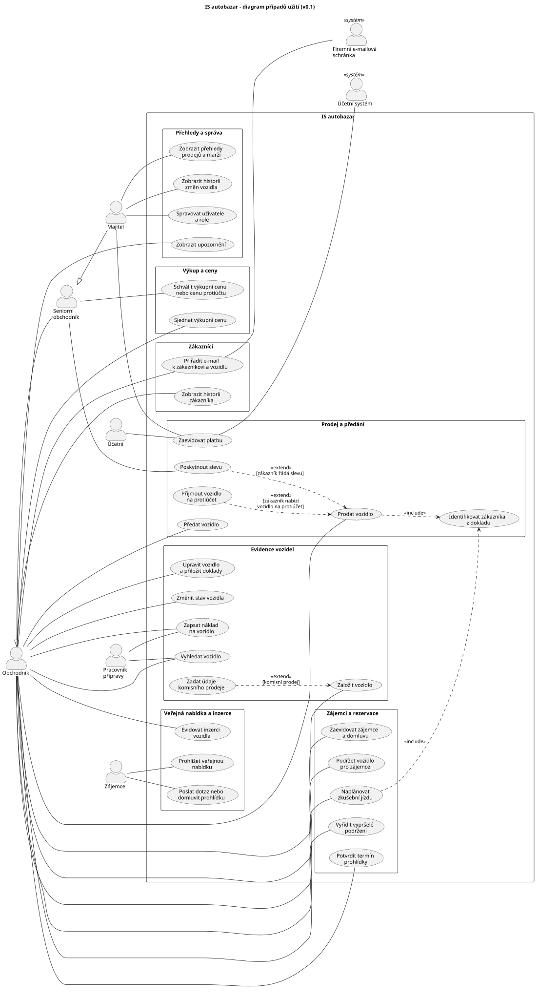

# Případy užití

| Verze | Datum | Autor | Změna |
| --- | --- | --- | --- |
| 0.1 | 15. 10. 2026 | Jan Svoboda | První verze UC diagramu a seznamu případů užití s trasováním na požadavky (#9). Připraveno s pomocí AI, ověřeno proti [katalogu požadavků](../03-pozadavky/katalog-pozadavku.md) v0.1. |

## Diagram

Zdroj: [`diagrams/uc-diagram.puml`](../diagrams/uc-diagram.puml). Aktéři jsou popsaní v [akteri.md](akteri.md).

**Hranice systému** zatím vychází z kap. 7 zadání v1.0 (mimo rozsah). Po dokončení vymezení rozsahu (#7) se zkontroluje. Mimo systém zůstává:

- publikování inzerátů na externí portály,
- online platby,
- samotný přepis v registru vozidel,
- účetnictví.

**Přihlášení** se jako samostatný případ užití nekreslí. Je předpokladem všech případů užití zaměstnanců (N6).

## Seznam případů užití

Číslo UC je stabilní stejně jako ID požadavků. Zrušený UC si své číslo ponechá.

| UC | Název | Aktéři | Požadavky | Poznámka |
| --- | --- | --- | --- | --- |
| UC01 | Založit vozidlo | Obchodník | F1, F2, F6, N9 | Lze i před přivezením vozidla. |
| UC02 | Zadat údaje komisního prodeje | Obchodník | F8 | `extend` UC01, podmínka: komisní prodej. |
| UC03 | Upravit vozidlo a přiložit doklady | Obchodník | F1, F3, F29 | |
| UC04 | Zapsat náklad na vozidlo | Obchodník, Pracovník přípravy | F4 | Oprávnění pracovníka přípravy nezvalidováno (OT1). |
| UC05 | Změnit stav vozidla | Obchodník | kap. 2.1 katalogu, F16 | Stavy jsou předpoklad (OT11). |
| UC06 | Vyhledat vozidlo | Obchodník, Pracovník přípravy | F5, N5 | |
| UC07 | Sjednat výkupní cenu | Obchodník | F7 | |
| UC08 | Schválit výkupní cenu nebo cenu protiúčtu | Seniorní obchodník | F7, F9 | |
| UC09 | Zaevidovat zájemce a domluvu | Obchodník | F10 | |
| UC10 | Podržet vozidlo pro zájemce | Obchodník | F11, F12, N5 | Vztah podržení, zálohy a rezervace je otevřený (OT12). |
| UC11 | Naplánovat zkušební jízdu | Obchodník | F14 | `include` UC20. |
| UC12 | Vyřídit vypršelé podržení | Obchodník | F13 | |
| UC13 | Potvrdit termín prohlídky | Obchodník | F17 | Navazuje na UC15. |
| UC14 | Prohlížet veřejnou nabídku | Zájemce | F15, F16, F18, L4, N7 | F18 a L4 jsou otevřené (OT4). |
| UC15 | Poslat dotaz nebo domluvit prohlídku | Zájemce | F17 | |
| UC16 | Evidovat inzerci vozidla | Obchodník | F19 | Priorita S. |
| UC17 | Přiřadit e-mail k zákazníkovi a vozidlu | Obchodník; Firemní e-mailová schránka | F20 | Priorita S. |
| UC18 | Zobrazit historii zákazníka | Obchodník | F21 | |
| UC19 | Prodat vozidlo | Obchodník | F8, F22 | `include` UC20. |
| UC20 | Identifikovat zákazníka z dokladu | (přes UC11, UC19) | F14, L2, L8 | Sdílený krok zkušební jízdy a prodeje. |
| UC21 | Poskytnout slevu | Seniorní obchodník | F25, F29 | `extend` UC19, podmínka: zákazník žádá slevu. |
| UC22 | Přijmout vozidlo na protiúčet | (přes UC19) | F9 | `extend` UC19. Vozidlo se zakládá jako nové a cenu schvaluje UC08. |
| UC23 | Předat vozidlo | Obchodník | F23, L5, L6 | |
| UC24 | Zaevidovat platbu | Účetní, Majitel; Účetní systém | F24, F26, L1 | F24 a L1 jsou otevřené (OT3). Kdo eviduje zálohu, je otevřené. |
| UC25 | Zobrazit upozornění | Obchodník | F13, F27, L5, L7 | |
| UC26 | Zobrazit přehledy prodejů a marží | Majitel | F28 | Priorita S. Zda je vidí i seniorní obchodník, je otevřené. |
| UC27 | Zobrazit historii změn vozidla | Majitel | F29 | |
| UC28 | Spravovat uživatele a role | Majitel | N6, kap. 2.8 katalogu | Nezvalidováno (OT1). |

Seniorní obchodník a majitel dědí všechny případy užití obchodníka (generalizace aktérů).

## Pokrytí požadavků

Funkční požadavky F1–F29 jsou pokryté všechny. Z nefunkčních a legislativních se do UC promítají N5, N6, N7, N9, L1, L2, L4–L8. Ostatní (N1–N4, N8, L3) jsou vlastnosti celého systému a v diagramu se nezobrazují.

## Otevřené body k diagramu

- Kdo eviduje zálohu: obchodník při podržení, nebo účetní? (F24, OT3)
- Smí pracovník přípravy měnit stav vozidla z „V přípravě“ na „Připraveno k prodeji“? (OT1, OT11)
- Vidí přehledy prodejů a marží i seniorní obchodník? (F28)
