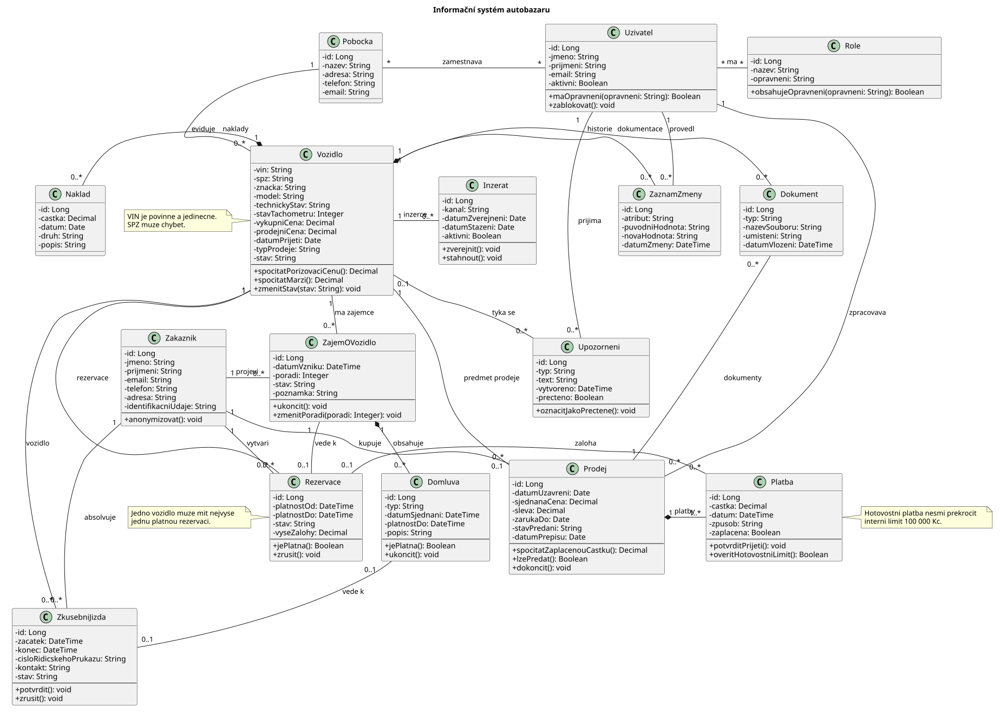

| Verze | Datum | Autor | Změna |
| --- | --- | --- | --- |
| 0.1 | 05. 11. 2026 | Martin Špaňúr | Brainstorming nápadů ze zadání.
| 0.2 | 19. 11. 2026 | Martin Špaňúr | Dokončení seznamu tříd a generace diagramu. |

# Seznam tříd

|JMENO | POPIS | SPOLUPRACUJE|
| --- | --- | --- |
| Pobočka | Pobočka představuje konkrétní provozovnu autobazaru. Uchovává její název, adresu, telefon, e-mail a případně otevírací dobu. Určuje, kde se nacházejí jednotlivá vozidla a kde probíhají činnosti, jako jsou zkušební jízdy, rezervace a prodeje. | Pobočka eviduje vozidla, která se na ní aktuálně nacházejí, a uživatele, kteří na ní pracují. Na pobočce se uskutečňují zkušební jízdy a prodeje. Rezervace lze spojit s pobočkou, na které si má zákazník vozidlo prohlédnout nebo převzít. Pokud se vozidlo přesune na jinou pobočku, změní se jeho aktuální pobočka. Jeden uživatel může působit na více pobočkách, například majitel nebo seniorní obchodník. |
| Vozidlo | Představuje konkrétní automobil vedený autobazarem. Uchovává VIN, SPZ, značku, model, technický stav, stav tachometru, výkupní a prodejní cenu, datum přijetí, typ prodeje a aktuální stav vozidla. VIN musí být povinné a jedinečné, zatímco SPZ může chybět. Vozidlo také poskytuje podklady pro výpočet pořizovací ceny a marže. |Vozidlo má přiřazen právě jeden typ prodeje a může obsahovat více nákladů, dokumentů a fotografií. Se zákazníky je propojeno prostřednictvím zájmů o vozidlo. Může mít rezervace, zkušební jízdy a následně jeden prodej. Zveřejnění vozidla zajišťuje inzerát a změny jeho ceny, stavu nebo slevy zaznamenává záznam změny. Pokud bylo vozidlo přijato na protiúčet, může odkazovat na původní prodej. |
| Zákazník | Reprezentuje osobu, která projevila zájem o vozidlo, absolvovala zkušební jízdu nebo vozidlo koupila. Uchovává jméno, příjmení, kontaktní údaje, adresu a v případech vyžadovaných prodejem také identifikační údaje. Číslo řidičského průkazu se eviduje pouze v souvislosti se zkušební jízdou. Historie zákazníka zahrnuje jeho zájmy, domluvy, nákupy, doklady a poprodejní kontakty. | Zákazník může mít prostřednictvím zájmů o vozidlo zájem o více vozidel. Může vytvářet rezervace, účastnit se zkušebních jízd a vystupovat jako kupující v prodeji. Zároveň může být plátcem jedné nebo více plateb a jeho údaje mohou být použity v dokumentech, například v kupní smlouvě nebo předávacím protokolu. Na zákazníka se také vztahují pravidla pro uchování a anonymizaci osobních údajů. |
| ZajemOVozidlo | Představuje vazbu mezi zákazníkem a konkrétním vozidlem. Samostatná třída je vhodnější než přímá vazba Zakaznik–Vozidlo, protože zájem má vlastní pořadí, stav, datum vzniku a přiřazeného obchodníka. Vozidlo může mít více zájemců, ale platnou rezervaci může mít vždy jen jeden. | Zájem o vozidlo propojuje jednoho zákazníka s jedním vozidlem. Uchovává pořadí zákazníka mezi ostatními zájemci a může obsahovat několik domluv. Ze zájmu může následně vzniknout rezervace. Každý zájem spravuje konkrétní uživatel, zpravidla obchodník. | 
| Domluva | Eviduje konkrétní dohodu se zákazníkem. Typem domluvy může být prohlídka, zkušební jízda, podržení, záloha nebo podpis dokumentu. U každé domluvy musí být zaznamenáno, kdo ji sjednal a kdy. | Domluva patří ke konkrétnímu zájmu o vozidlo a vytváří ji uživatel, zpravidla obchodník. Domluva typu zkušební jízda může vést k vytvoření zkušební jízdy. Domluva typu podržení nebo záloha může vést k vytvoření rezervace. Pokud domluva vyprší, může být vytvořeno upozornění. Po vypršení domluvy typu podržení systém upozorní obchodníka, který ji sjednal, a vozidlo může být nabídnuto dalšímu zájemci v pořadí. |
| Rezervace | Dočasně blokuje vozidlo pro konkrétního zákazníka. Uchovává začátek, konec platnosti, stav rezervace a případně informaci o záloze. Musí zajistit, že pro jedno vozidlo nebude současně existovat více platných rezervací. | Rezervace patří jednomu vozidlu a jednomu zákazníkovi. U jednoho vozidla může být současně platná nejvýše jedna rezervace. Rezervace může souviset se zájmem o vozidlo, domluvou a zálohovou platbou. Přesný vztah mezi podržením, zálohou a rezervací řeší přiřazený obchodník. |
| ZkusebniJizda | Představuje naplánovanou nebo uskutečněnou zkušební jízdu. Uchovává datum, čas, vozidlo, jméno zákazníka, číslo jeho řidičského průkazu a kontaktní údaj. Jízdy se zobrazují v kalendáři. | Zkušební jízda probíhá s jedním vozidlem a účastní se jí jeden zákazník. Plánuje nebo potvrzuje ji uživatel a může vzniknout na základě předchozí domluvy. Před jejím naplánováním se kontroluje, zda je vozidlo připravené k prodeji. |
|Prodej | Reprezentuje obchodní případ, při kterém zákazník kupuje vozidlo. Uchovává datum uzavření, sjednanou cenu, slevu, záruční lhůtu, stav předání a stav přepisu vozidla. Prodej musí před předáním ověřit splnění kontrolního seznamu. | Prodej spojuje právě jedno vozidlo s jedním zákazníkem a zpracovává jej konkrétní uživatel. Obsahuje jednu nebo více plateb a související dokumenty, například kupní smlouvu nebo předávací protokol. Součástí prodeje jsou také položky kontrolního seznamu. Prodej může odkazovat na nové vozidlo přijaté na protiúčet. Po uzavření se účetní údaje předávají do systému Pohoda. Pokud není vozidlo včas přepsáno, vytvoří se upozornění. |
| Platba | Eviduje jednotlivou platbu související s prodejem nebo rezervací. Uchovává částku, datum, způsob platby a stav zaplacení. Podporované způsoby jsou převod, karta, hotovost a úvěr, včetně zálohy. U hotovosti musí systém hlídat interní limit 100 000 Kč. | Platba primárně patří k prodeji, ale zálohová platba může být spojena také s rezervací. Plátcem je zákazník. Platbu eviduje uživatel v roli majitele nebo účetního. U prodeje na úvěr a u podezřelého obchodu je před dokončením prodeje vyžadována identifikace zákazníka. Údaje o platbě mohou být následně předány do účetního systému Pohoda. |
| Naklad |Představuje finanční náklad spojený s přípravou nebo pořízením vozidla. Uchovává částku, datum, druh nákladu a případně popis. Druhem může být oprava, převoz nebo příprava vozidla. | Náklad patří právě jednomu vozidlu a zadává jej oprávněný uživatel, například pracovník přípravy nebo obchodník. Náklady ovlivňují výpočet pořizovací ceny vozidla. Společně s výkupní a prodejní cenou také ovlivňují výslednou marži. |
| Dokument | Reprezentuje dokument přiložený nebo vytvořený v systému. Může jít o technický průkaz, smlouvu, protokol STK, plnou moc, kupní smlouvu nebo předávací protokol. Dokument má typ, datum vložení, umístění souboru a informaci o uživateli, který jej vložil nebo vytvořil. | Dokument může patřit k vozidlu nebo k prodeji. Prodejní dokumenty používají údaje zákazníka a vozidla. Dokument vkládá nebo vytváří uživatel a jeho přítomnost může být kontrolována položkou kontrolního seznamu. U komisního prodeje může být vyžadován konkrétní dokument, například plná moc. |
| Inzerat | Inzerát eviduje zveřejnění vozidla ve veřejné nabídce nebo v jiném inzertním kanálu. U externích kanálů systém pouze zaznamenává, kde a od kdy je vozidlo inzerováno; automatické publikování neprovádí. Ve veřejné nabídce se zobrazují pouze připravená a rezervovaná vozidla. Rezervovaná vozidla jsou označena a prodaná se nezobrazují. | Inzerát patří jednomu vozidlu a zobrazuje jeho fotografie. U komisního vozidla může obsahovat informaci o komisním prodeji. Z veřejného inzerátu může vzniknout zájem o vozidlo nebo domluva. Po prodeji vozidla se inzerát deaktivuje nebo se vytvoří upozornění na jeho stažení. |
| Uzivatel | Představuje zaměstnance používajícího interní část systému. Má vlastní účet s e-mailem a heslem a může být zablokován. Jeden uživatel může mít více rolí a výsledná oprávnění vznikají sjednocením jeho rolí. | Uživatel má jednu nebo více rolí. Může zakládat a upravovat vozidla, spravovat zájmy o vozidla, domluvy, rezervace a zkušební jízdy. Také může provádět prodej a podle svých oprávnění zadávat náklady, platby nebo slevy. Uživatel je uveden jako autor v záznamech změn a přijímá upozornění. |
| Role | Určuje oprávnění uživatele. Mezi požadované role patří majitel, seniorní obchodník, obchodník, účetní a pracovník přípravy. Role ovlivňuje například přístup k cenám a marži, schvalování výkupní ceny, poskytování slev, práci s platbami nebo správu uživatelů. | Role může být přiřazena jednomu nebo více uživatelům a prostřednictvím oprávnění řídí jejich operace nad ostatními třídami. Majitel může spravovat uživatele a rozhodovat o seniorních obchodnících. Majitel nebo seniorní obchodník může schvalovat výkupní cenu, cenu vozidla přijatého na protiúčet a poskytované slevy. |
| Upozorneni | Informuje konkrétního uživatele o události vyžadující řešení. Typicky jde o končící rezervaci, chybějící doklady před předáním, neprovedený přepis nebo dlouho neprodané vozidlo. | Upozornění je adresováno jednomu nebo více uživatelům a může odkazovat na vozidlo, rezervaci nebo prodej. Vzniká například při vypršení rezervace nebo podržení, při nesplnění kontrolního seznamu nebo v případě, že nebyl včas proveden přepis vozidla. |
| ZaznamZmeny | Vytváří neměnnou auditní historii změn vozidla. Uchovává změněný atribut, původní hodnotu, novou hodnotu, čas změny a uživatele, který změnu provedl. Zvlášť důležité jsou změny ceny, stavu a slevy. Auditní záznam nelze následně upravit ani smazat. | Záznam změny patří jednomu vozidlu a odkazuje na uživatele, který změnu provedl. Může evidovat také změny související s prodejem, například přidání slevy. Slouží jako podklad pro kontrolu a zobrazení historie vozidla. |

# Diagram tříd

Některé části dokumentu byly vygenerované AI.